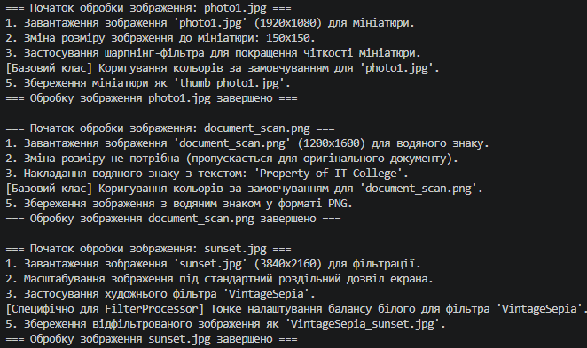

# Лабораторна робота №11: Template Method Pattern

**Тема:** Патерн проєктування Template Method на прикладі `ImageProcessor` (Варіант 9)  
**Інструмент:** .NET SDK, C#  

---

## 📋 Опис проєкту

Цей проєкт демонструє використання патерну **Template Method (Шаблонний метод)** у мові C#. Патерн визначає скелет алгоритму в базовому абстрактному класі, делегуючи конкретні кроки похідним класам.

### Архітектура:
* **Базовий клас (`ImageProcessor`)**: Містить шаблонний метод `Process()`, який задає чітку послідовність кроків обробки:
  1. `Load()` (абстрактний)
  2. `Resize()` (абстрактний)
  3. `ApplyFilter()` (абстрактний)
  4. `AdjustColors()` (віртуальний з базовою реалізацією)
  5. `Save()` (абстрактний)
* **Похідні класи**:
  * `ThumbnailProcessor` — створення мініатюр зображень.
  * `WatermarkProcessor` — накладання водяного знаку.
  * `FilterProcessor` — застосування художніх фільтрів із тонким настроюванням кольорів.

## Висновок

Під час виконання лабораторної роботи №11 було успішно освоєно та застосовано на практиці патерн проєктування **Template Method (Шаблонний метод)** на прикладі сервісу обробки зображень (`ImageProcessor`, Варіант 9).

У ході роботи було досягнуто таких результатів:
* Створено абстрактний базовий клас, який визначає незмінний скелет алгоритму обробки зображень, що дозволяє уникнути дублювання коду за принципом **DRY**.
* Реалізовано три похідні класи (`ThumbnailProcessor`, `WatermarkProcessor`, `FilterProcessor`), які специфікують обов'язкові кроки (через `abstract` методи) та за потреби адаптують базову логіку (через `virtual` методи).
* Продемонстровано механізм поліморфізму в методі `Main`: об'єкти різних підкласів збережено в єдиному списку базового типу, для якого коректно й послідовно викликається загальний шаблонний метод `Process()`.

Отримані навички демонструють переваги використання абстрактних класів для керування складними послідовностями операцій та забезпечення єдиного порядку виконання кроків у єдиній архітектурі.

