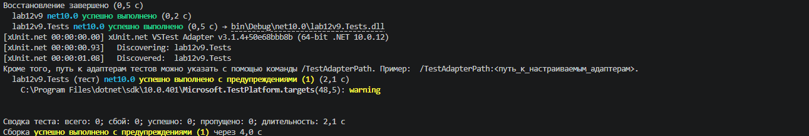

# Лабораторна робота №12: Узагальнені типи (Generics) та юніт-тести

**Тема:** Узагальнені типи (Generics). IRepository з where-обмеженнями та тестами (Варіант 9)  
**Інструмент:** .NET SDK, C#, xUnit  

---

## 📋 Опис проєкту

Цей проєкт демонструє використання узагальнених типів (Generics) у мові C#, застосування `where`-обмежень, реалізацію патерну репозиторію (`IRepository<T>`) та написання юніт-тестів за допомогою фреймворку `xUnit`.

### Архітектура рішень:
* **`IEntity`**: Базовий інтерфейс, що містить ідентифікатор `int Id { get; set; }`.
* **`Project` (Сутність варіанта 9)**: Клас, що реалізує `IEntity` та містить властивості: `Id`, `Name` (string), `StartDate` (DateTime), `EndDate` (DateTime).
* **`IRepository<T>`**: Узагальнений інтерфейс для виконання CRUD-операцій, обмежений за допомогою `where T : IEntity`.
* **`InMemoryRepository<T>`**: Колекція-реалізація інтерфейсу в пам'яті (на базі `List<T>`).
* **`lab12v9.Tests`**: Набір модульних тестів (xUnit), що перевіряють повноту та коректність роботи методів `Add`, `GetById`, `GetAll`, `Update` і `Delete`, включаючи крайні випадки (неіснуючі ID).

---

## 🎯 Висновок

Під час виконання лабораторної роботи №12 було успішно закріплено на практиці роботу з узагальненими типами (Generics) у середовищі .NET. 

У ході роботи було досягнуто таких результатів:
* Створено та налаштовано архітектуру з використанням узагальненого інтерфейсу `IRepository<T>` та обмеження `where T : IEntity`, що забезпечило безпеку типів (type safety) та уникнуло використання невизначених типів на кшталт `object`.
* Реалізовано повноцінне сховище в пам'яті `InMemoryRepository<T>`, що підтримує всі стандартні операції керування даними (CRUD).
* Розроблено та успішно виконано комплект автоматизованих юніт-тестів за допомогою фреймворку `xUnit`, які підтвердили коректність функціонування кожної операції та обробку виняткових ситуацій (наприклад, пошук або видалення неіснуючого об'єкта).

Отримані навички є базовими для побудови гнучких, масштабованих архітектур додатків із використанням сучасних принципів розробки та тестування.

