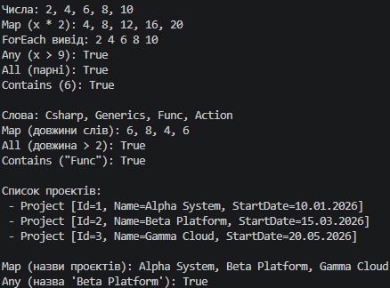

# Лабораторна робота №13: Generic-методи та функції вищого порядку

**Тема:** Generic-методи для повторного використання компонентів: Mapper/MaxBy/Reduce з Func/Action (Варіант 9)  
**Інструмент:** .NET SDK, C#  

---

## 📋 Опис проєкту

Цей проєкт присвячений створенню узагальнених (**generic**) методів і використанню делегатів вищого порядку (`Func<T, TResult>`, `Action<T>`, `Predicate<T>`) у мові C#. 

Згідно з **варіантом 9**, у класі `FunctionalUtils` було реалізовано 5 методів:
1. **`Map<T, TResult>`** — трансформує кожен елемент колекції за допомогою функції `Func<T, TResult>`.
2. **`ForEach<T>`** — виконує дію `Action<T>` над кожним елементом колекції.
3. **`Any<T>`** — перевіряє, чи виконується умова (`Predicate<T>`) хоча б для одного елемента.
4. **`All<T>`** — перевіряє, чи виконується умова для всіх елементів колекції.
5. **`Contains<T>`** — перевіряє наявність конкретного елемента у списку.

Кожен метод продемонстровано в роботі з різними типами даних: примітивними (`int`), стандартними (`string`) та власним користувацьким класом (`Project`).

---

## 🎯 Висновок

Під час виконання лабораторної роботи №13 було успішно опановано створення та застосування узагальнених (**generic**) методів і функцій вищого порядку в середовищі .NET.

У ході роботи було досягнуто таких результатів:
* Реалізовано гнучкі шаблони обробки даних за допомогою делегатів `Func`, `Action` та `Predicate`, що дозволило відокремити бізнес-логіку обходу колекцій від правил їх трансформації чи перевірки.
* Забезпечено багаторазове використання коду (**reusability**) завдяки узагальненим типам, що дозволило одному й тому ж методу працювати як зі стандартними типами (`int`, `string`), так і зі складними об'єктами (`Project`).
* Закріплено на практиці використання лямбда-виразів як компактного способу передачі поведінки в якості параметрів методів.

Отримані навички є фундаментом для розуміння та ефективного використання технології LINQ у сучасній розробці на C#.

